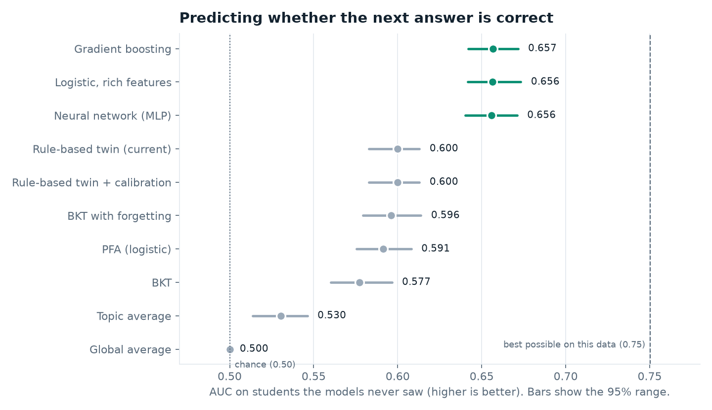
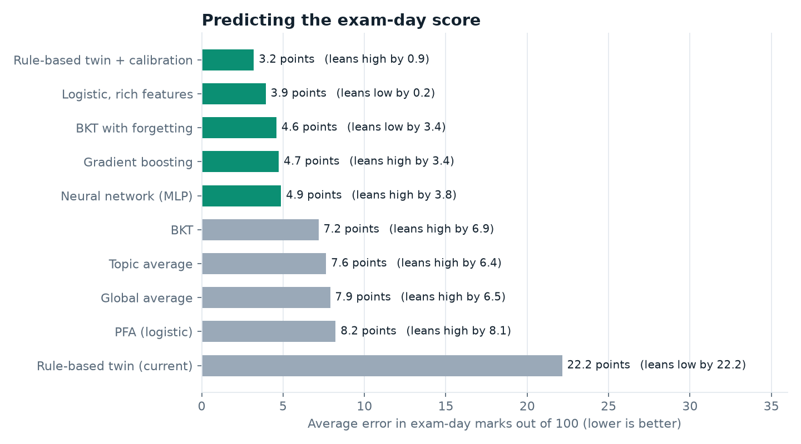
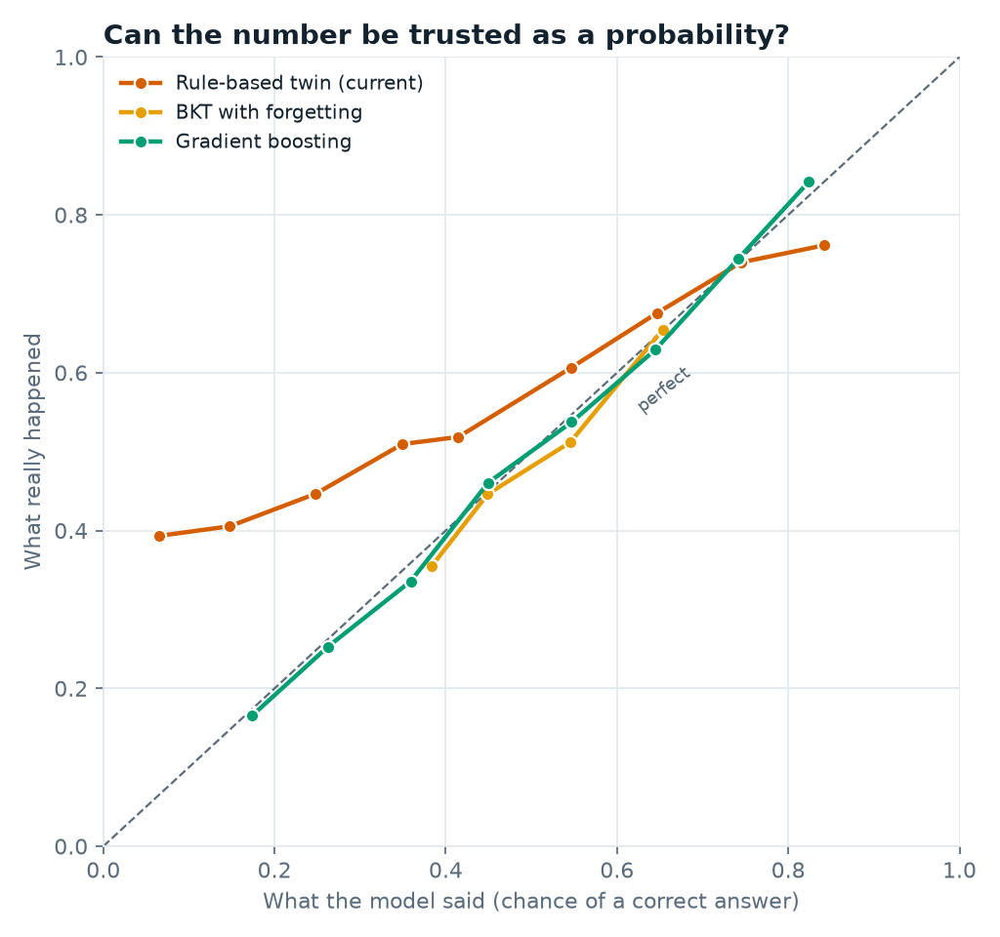
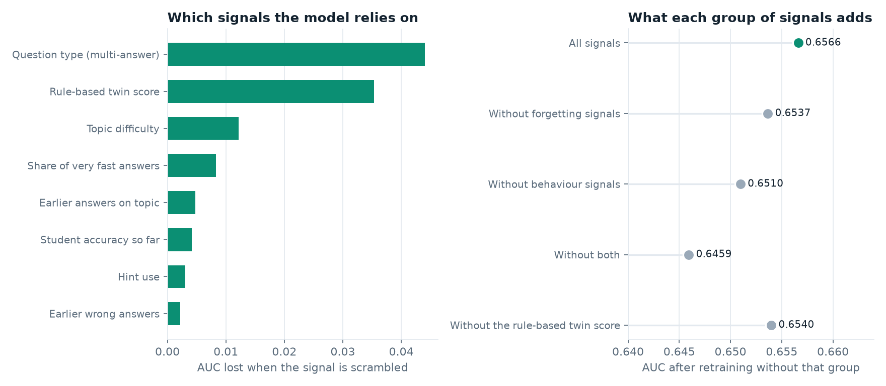
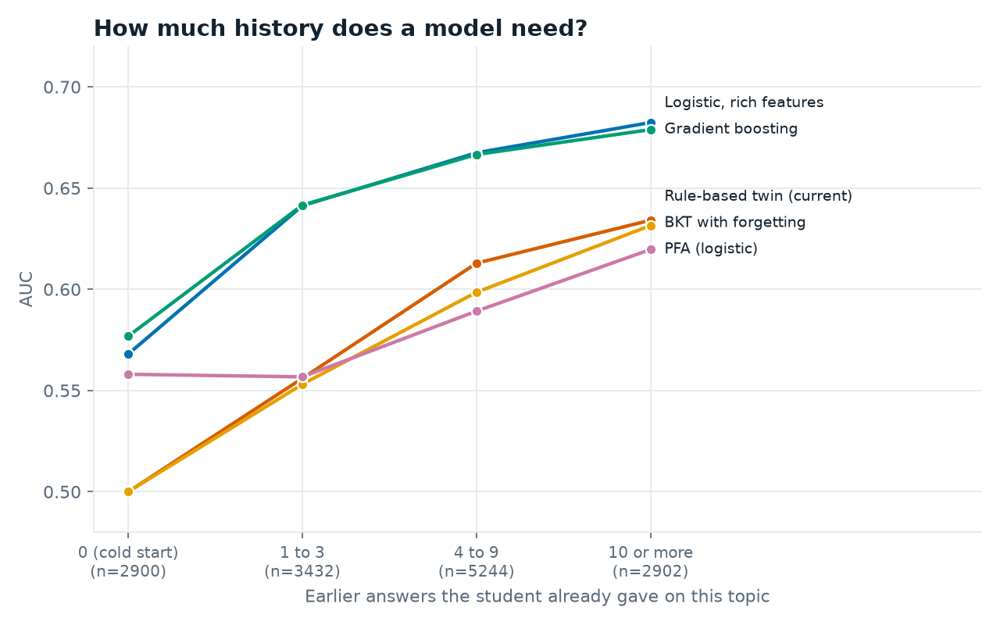

# Component 1: trained model and synthetic dataset (supervisor evidence)

Cognitive Digital Twin, AdaptiveLearnSE (SE-317). All code, data and charts are in `ai-services/c1/ml/`.

## 1. What we did, in plain words

1. **Made a synthetic dataset.** 600 invented students (S0001 to S0600) take the diagnostic test on day 0 and then do practice quizzes for 3 to 8 weeks. The data has the same fields as the real app: topic, right or wrong, time taken, hint used, tab leaves, question type, day. It has **77,270 answers**, 8,990 quiz sessions and 46 real topic names. No real student data is used.
2. **Trained 9 models** on 360 of the students, tuned them on 120 more, and **tested them only on 120 students they had never seen**.
3. **Asked two questions.** (a) Will the student get the next answer right? (b) What will the student score on exam day, one week after the last practice?
4. **Checked if differences are real** by re-sampling the test students 300 times (95% ranges).

Why synthetic: real logs are not available yet and would need ethics approval and anonymising. The simulator uses a different maths form from every model (power-law forgetting, learning that spreads to other topics in the same module, student-specific speeds), so no model gets a free win. The simulator also tells us the **true** chance of each answer, so we can show the best possible score (an "oracle") and see how close each model gets.

## 2. Result in one table

Higher AUC is better (0.5 = guessing). Lower log loss and exam error are better.

| Model | AUC (next answer) | Log loss | Exam-day error (marks) | Verdict |
|---|---|---|---|---|
| Global average | 0.500 | 0.694 | 7.9 | No personalisation |
| Topic average | 0.530 | 0.692 | 7.6 | Same for every student |
| Rule-based twin (current) | 0.600 | 0.786 | 22.2 | Ranks students well, but its score is not a probability |
| Rule-based twin + calibration | 0.600 | 0.677 | **3.2** | Best exam-day predictor |
| BKT | 0.577 | 0.679 | 7.2 | Assumes knowledge never fades |
| BKT with forgetting | 0.596 | 0.677 | 4.6 | Better, still ignores behaviour |
| PFA (logistic) | 0.591 | 0.680 | 8.2 | Only counts rights and wrongs |
| Logistic, rich features | 0.656 | **0.653** | 3.9 | Ties for best, easiest to explain |
| Neural network (MLP) | 0.656 | 0.654 | 4.9 | Ties, hard to explain |
| **Gradient boosting** | **0.657** | **0.653** | 4.7 | **Best on the numbers** |
| *Best possible (oracle)* | *0.750* | *0.590* | | *Ceiling on this data* |



## 3. Which model is best, and why the others are not

**Best model: gradient boosting on rich history features.** It has the highest AUC (0.657) and the lowest log loss (0.653), about 0.06 AUC above the current rule-based twin, and it reaches 63% of the way from guessing to the best possible score. The 95% ranges show it is **clearly better than every simple model** (BKT, PFA, the twin, the averages).

**Be honest about the tie.** Logistic regression with the same features (0.656) and the neural network (0.656) are statistically tied with it (the 95% range of their difference includes zero). So the gain comes from the **signals we feed in**, not from a fancier algorithm. That is a useful finding: the Digital Twin idea of combining performance, behaviour and forgetting works.

| Model | Why it is not the best |
|---|---|
| Global and topic average | They give every student the same answer. Nothing personal. |
| Rule-based twin (current) | It ranks students well (rank agreement 0.84 with the true exam score, and 0.96 AUC for finding at-risk students). But the score is not a probability. Its log loss (0.786) is worse than guessing (0.694), and it predicts exam scores 22 marks too low. After calibration the log loss is fixed (0.677) and the exam error is the best of all (3.2), but it still ignores question type and answer behaviour, so its AUC stays 0.600. |
| BKT | Assumes knowledge never fades and looks only at right or wrong. AUC 0.577. |
| BKT with forgetting | Adding forgetting helps (0.596, exam error 4.6), but it still ignores speed, hints, tab leaves and question type. |
| PFA | Counts earlier rights and wrongs only. No forgetting and no behaviour. AUC 0.591. |
| Logistic, rich features | Ties for best. We keep it as the **explainable fallback** because every weight can be read. |
| Neural network (MLP) | Ties, needs more tuning and is a black box. Its exam error is also slightly worse (4.9). |
| Deep knowledge tracing (DKT) and transformers | **Not run.** This environment has no deep-learning library, and these models usually need thousands of real students. They are also black boxes, which clashes with the explainable AI promise in the TAF. A good extension is to test them on the public ASSISTments or EdNet data named in the TAF. |

## 4. The two questions have two winners, so the system uses both

- **Next-answer prediction:** gradient boosting wins (AUC 0.657 against 0.600 for the twin).
- **Exam-day score:** the **calibrated rule-based twin** wins (3.2 marks off), with logistic regression close behind (3.9).



So the design for Component 1 is a **hybrid**: keep the explainable twin for the dashboard, "why this score" and exam readiness (after calibration), and add the trained model for next-answer chance and recommendations. The twin score is also the **second most important signal inside the trained model**, so the two work together.



## 5. What the TAF novelty claims look like in numbers

The TAF promises "behaviour plus performance fusion" and "forgetting curve with engagement". We retrained the model without each group of signals:

| Retrained without | AUC | Change |
|---|---|---|
| Nothing removed | 0.6566 | |
| Forgetting signals | 0.6537 | -0.003 |
| Behaviour signals (time, hints, tab leaves) | 0.6510 | -0.006 |
| Both | 0.6459 | -0.011 |



The effect is small but consistent, and the "fast answers" signal is the 4th most important. We say this plainly: on synthetic data the gain from fusion is modest, and it needs to be re-checked on real data.

## 6. How much history does a model need?



Every model is weak on the very first answer in a topic (AUC about 0.58 at best), and all improve with practice. This is why the **baseline diagnostic test** is part of the design: it gives the twin a starting point.

## 7. Honest limits (say these before the supervisor does)

1. The data is **synthetic**. The results show the method works when the world behaves like our simulator. They do not prove it on real SLIIT students.
2. The best possible AUC on this data is 0.75 because of guessing and slips, so 0.657 is not "low", it is about 63% of the way to the ceiling.
3. The top three models are tied. We do not claim gradient boosting is better than logistic regression.
4. The ablation gains (0.003 to 0.011 AUC) are small.
5. The rule-based twin is re-implemented from its rules in `features.py`. It matches the app's logic but is not the app's own code.
6. Not run: DKT, transformers, reinforcement learning (that is Component 4's area).

**Next step with real data:** a small voluntary pilot with consent and anonymised IDs, then run the same scripts (`train_compare.py`) on the real log. The code is written so that real events only need the same columns as `synthetic_events.csv`.

## 8. Likely supervisor questions

| Question | Short answer |
|---|---|
| Why synthetic data? | Real logs do not exist yet, need ethics clearance and anonymising. Synthetic data lets us test the method now, and the simulator gives the true answer for checking. |
| Is it rigged to favour your model? | The simulator uses a different forgetting curve and other rules from every model. We also show the oracle ceiling (0.75) and a 95% range from re-sampling students. |
| Which model is best? | Gradient boosting for next-answer prediction (tied with logistic regression). The calibrated twin for exam-day score. We use both. |
| Why not just use deep learning? | Not enough data to justify it, black box against the explainable-AI goal, and logistic regression already matches the neural network here. Listed as a future test on public data. |
| Why keep the rule-based twin? | It works from the first answer, every change can be explained to the student, and after calibration it predicts exam scores best. |
| What is the trained model used for? | Chance of getting the next question right, and as an input to recommendations in Component 4. The dashboard still shows the explainable twin score. |
| How do you know it is not overfitting? | Models are tested on 120 students never seen in training or tuning. |
| What is the weakest part? | Everything rests on synthetic data, and the gain from behaviour and forgetting signals is small. |

## 9. Files

- `ai-services/c1/ml/generate_synthetic.py`: makes the dataset (`data/synthetic_*.csv`, anonymised IDs S0001 and up).
- `ai-services/c1/ml/features.py`: builds features using only what was known before each answer, plus the rule-based twin.
- `ai-services/c1/ml/bkt.py`: BKT with and without forgetting.
- `ai-services/c1/ml/train_compare.py`: trains and tests all models, writes `reports/results.json` and `reports/model_comparison.csv`.
- `ai-services/c1/ml/make_charts.py`: draws the charts.
- `ai-services/c1/ml/predict.py` and `models/gbm_next_answer.joblib`: the trained model.

Re-run everything:

```
cd ai-services\c1\ml
pip install -r requirements.txt
python generate_synthetic.py
python train_compare.py
python make_charts.py
```
