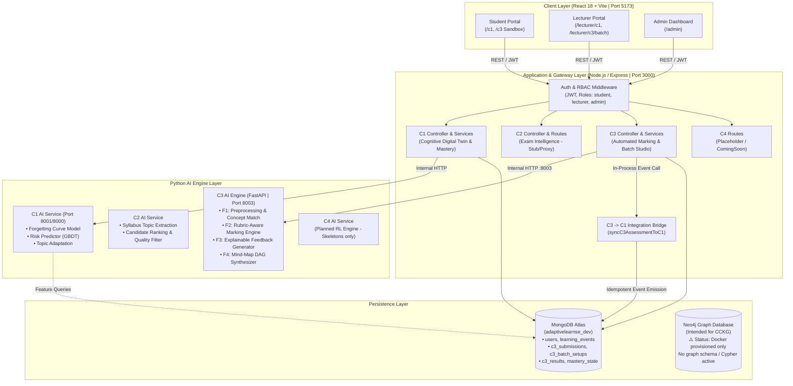
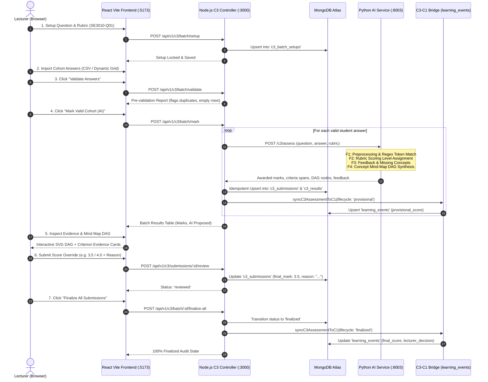

# AdaptiveLearnSE — Master System Architecture & Runtime Topology

**Document Version:** 2.0.0 (Authoritative PP1 Architecture)  
**System Milestone:** Project Performance 1 (PP1) Evaluation  
**Target Date:** 22, 23, and 26 October 2026  
**Scope:** Full Ecosystem Architecture with Component 3 (C3) Deep Dive  

---

## 1. High-Level Ecosystem Architecture

AdaptiveLearnSE operates as a multi-tier, micro-service-oriented platform consisting of a unified Single Page Application (SPA), an Express API Gateway / Application Server, dedicated Python AI microservices per component, and shared database systems.

---

## 2. Component 3 (C3) Runtime Topology & Internal Architecture

Component 3 is divided cleanly between an asynchronous Node.js orchestrator and an in-process, high-efficiency Python FastAPI NLP evaluation service.

---

## 3. Component Boundaries & Ownership Status

| Component | Official Project Scope | Responsible Owner | Implementation Reality in Repository | Runtime Status for PP1 |
| :--- | :--- | :--- | :--- | :--- |
| **Component 1 (C1)** | Cognitive Digital Twin, Learning State, Risk Prediction, Practice Engine | Teammate (Protected) | Fully functional backend (`modules/c1/`), active UI pages (`DashboardPage`, `TopicInsightsPage`, `ClassInsights`), GBDT model, and pilot analysis. | ✅ **Operational & Tested** |
| **Component 2 (C2)** | Exam Intelligence, Past Paper Ingestion, Syllabus Topic Extraction | Teammate (Protected) | Python syllabus topic candidate extraction, quality filters, and ranking repository implemented in `ai-services/c2/`. Frontend UI is `ComingSoon`. | ⚠️ **AI Services Active; UI Placeholder** |
| **Component 3 (C3)** | AI-Powered Automated Marking, Rubric Evaluation, Mind Map Synthesis, Lecturer Governance | **Candidate (Candidate Owned)** | Fully functional: Batch Studio wizard, deterministic MCQ engine, rubric subjective evaluator, SVG DAG generator, MongoDB persistence, C1 bridge, 140 passing tests, 12 verified screenshots. | ✅ **Authoritative, Complete & PP1 Ready** |
| **Component 4 (C4)** | Reinforcement-Learning Adaptive Study Paths & Recommendation | Teammate (Protected) | Directory skeletons only (`ai-services/c4/`, `frontend/src/pages/c4/` contain `.gitkeep`). UI routes render `ComingSoon`. | ❌ **Deferred / Skeletons Only** |
| **Shared CCKG** | Co-Evolving Curriculum Knowledge Graph (Neo4j) | **Shared Architecture (Unassigned Owner)** | Docker Compose provisions a basic Neo4j:5 container. No Cypher scripts, graph schemas, or backend connection drivers exist in the codebase. | ❌ **Proposed Architecture Only (Unimplemented)** |

---

## 4. Security, Authentication & Role-Based Authorization (RBAC)

1. **Authentication:** Stateless JSON Web Tokens (JWT) signed using `JWT_SECRET`. Tokens are transmitted via the standard HTTP `Authorization: Bearer <token>` header.
2. **Role Authorization Hierarchy:**
   - **Student (`role: 'student'`):** Restricted to `/c1/*` and `/c3` student sandbox. Forbidden (HTTP 403) from accessing `/lecturer/*`, batch marking setup, lecturer review endpoints, or override endpoints.
   - **Lecturer (`role: 'lecturer'`):** Authorized to access `/lecturer/*`, configure batch rubrics, mark cohorts, view evidence, apply score overrides, and finalize submissions. Cannot impersonate other students.
   - **Admin (`role: 'admin'`):** Inherits all lecturer privileges plus access to `/admin` dashboard.
3. **Audit Trail & Provenance:**
   - The system tracks provenance (`student`, `pp1_demo`, `test_fixture`).
   - Every score override requires a non-empty `override_reason` string, preserving the original AI proposed mark (`automated_mark`) alongside the authoritative `final_mark` and `reviewed_by` timestamp.
