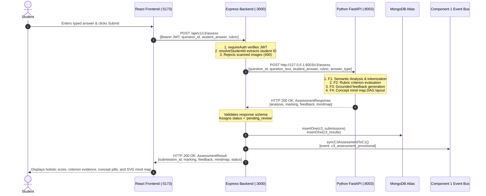

# AdaptiveLearnSE Component 3 — Actual Structure & Microservices Architecture Audit
**Project ID:** J26-SE-317 | **Academic Module:** IT4010 Research Project  
**Component:** Component 3 (C3) — AI-Powered Automated Marking & Answer Analysis System  
**Researcher:** T. P. V. K. Edirisinghe (IT23227118)  
**Audit Date:** 2026-10-20 | **Git HEAD:** `f21dba4` on `feature/c3-pp1-experiments-20261020`

---

## 1. Executive Summary

This report documents a comprehensive architectural audit of Component 3 (C3) within AdaptiveLearnSE. It establishes:
1. The **genuine filesystem structure** across the React frontend, Express.js backend, Python FastAPI microservice, MongoDB storage layer, and shared Neo4j curriculum ontology.
2. The **pedagogical and computational rationale** for separating the Python AI microservice from the Node.js backend.
3. The **actual end-to-end request flow** from client submission through Express authorization, Python NLP evaluation, MongoDB persistence, and cross-component event integration.
4. Verification of the **strict microservice boundaries**, confirming that Express does not duplicate AI logic, Python does not bypass application authorization, and live failures return explicit error states (502/504) rather than fabricating fake grades.
5. All 166 automated unit and live microservice integration tests pass with 0 failures.

---

## 2. Actual Repository Directory Tree

The directory tree below reflects the genuine codebase, omitting ephemeral dependencies (`node_modules`, `.venv`, `dist`, `__pycache__`, and `.pytest_cache`):

```
ADAPTIVE_LEARN_SE/
├── .env.example                               # Root-level environment template
├── .gitignore                                 # Git ignore specification
├── README.md                                  # Project overview and shared team contracts
│
├── frontend/                                  # React 18 + Vite Frontend Application (Port 5173)
│   ├── package.json                           # Frontend scripts and dependencies
│   ├── vite.config.js                         # Vite build configuration and proxy routing
│   ├── public/                                # Public assets and HTML evidence dashboards
│   │   ├── evidence_evaluation_results.html   # Empirical benchmark dashboard
│   │   ├── evidence_feedback.html             # Grounded formative feedback dashboard
│   │   ├── evidence_integration.html          # Cross-component event bus evidence
│   │   ├── evidence_mcq_result.html           # Deterministic MCQ evaluation result view
│   │   └── evidence_model_training.html       # Trainable GBR v2.0 regression report
│   └── src/
│       ├── App.jsx                            # React root routing (Protected & Role routes)
│       ├── components/                        # Shared UI components (Layout, AuthShell, etc.)
│       ├── context/AuthContext.jsx            # JWT authentication state management
│       ├── services/
│       │   ├── apiClient.js                   # Unified HTTP client routing to Express (/api/v1)
│       │   └── c3Api.js                       # C3 API wrapper (assessAnswer, review, finalize)
│       └── pages/c3/                          # Component 3 User Interface Pages
│           ├── AssessmentPage.jsx             # Student subjective & MCQ assessment studio
│           ├── LecturerBatchMarkingPage.jsx   # Lecturer batch authoring & CSV grading
│           ├── LecturerQueuePage.jsx          # Lecturer class submission review queue
│           ├── LecturerReviewPage.jsx         # Detailed review, mark override & finalization
│           ├── c3.css                         # Dedicated C3 styling and layout rules
│           ├── presets.js                     # Curriculum benchmark question presets
│           └── components/                    # C3 specialized presentation components
│               ├── ConceptDiagnosis.jsx       # Demonstrated vs missing concept pills
│               ├── CriterionCard.jsx          # Rubric scoring levels & evidence quotes
│               └── MindMapGraph.jsx           # SVG Directed Acyclic Graph (DAG) visualizer
│
├── backend/                                   # Node.js + Express Application Backend (Port 3000)
│   ├── package.json                           # Backend scripts and dependencies
│   ├── .env.example                           # Safe backend environment template
│   ├── seed_users.js                          # Local student & lecturer test account seeder
│   └── src/
│       ├── app.js                             # Express app setup and dynamic module mounting
│       ├── server.js                          # Server bootstrap and MongoDB connection
│       ├── config/
│       │   └── db.js                          # MongoDB Atlas native client connection
│       ├── middleware/
│       │   └── auth.js                        # JWT verification, RBAC (student/lecturer/admin)
│       ├── integration/                       # Inter-component event bridges
│       │   └── c3-c1/index.js                 # C3-to-C1 learning event dispatcher
│       └── modules/
│           ├── auth/                          # Authentication routes and controllers
│           ├── c1/                            # Component 1 (Cognitive Digital Twin) module
│           └── c3/                            # Component 3 Application Module
│               ├── README.md                  # C3 backend module documentation
│               ├── controllers/
│               │   └── c3Controller.js        # Controller: assess, review, finalize, batch
│               ├── routes/
│               │   └── index.js               # Route declarations mounted at /api/v1/c3
│               ├── services/
│               │   ├── aiClient.js            # HTTP client calling Python FastAPI service
│               │   ├── batchMarkingService.js # Lecturer batch question setup & CSV processing
│               │   ├── mcqMarkingService.js   # Deterministic objective MCQ grading engine
│               │   └── submissionService.js   # MongoDB submission persistence & C1 sync
│               └── tests/
│                   ├── c3.test.js             # Mocked backend integration tests (41 tests)
│                   └── c3_live_microservice.test.js # Live Express <-> FastAPI tests (6 tests)
│
├── ai-services/c3/                            # Python FastAPI AI Microservice (Port 8003)
│   ├── .env.example                           # Safe AI service environment template
│   ├── pyproject.toml                         # Python project metadata and dependencies
│   ├── requirements.txt                       # Locked dependencies (FastAPI, Scikit-learn, etc.)
│   ├── app/
│   │   ├── main.py                            # FastAPI application entry point & health check
│   │   ├── routes/                            # FastAPI API Route Handlers
│   │   │   ├── analysis.py                    # POST /analysis/answer (F1)
│   │   │   ├── marking.py                     # POST /marking/evaluate (F2)
│   │   │   ├── feedback.py                    # POST /feedback/generate (F3)
│   │   │   ├── mindmap.py                     # POST /mindmap/generate (F4)
│   │   │   └── assessment.py                  # POST /c3/assess & POST /assess (End-to-End)
│   │   └── schemas/                           # Pydantic v2 Input/Output Data Contracts
│   │       ├── analysis.py                    # AnswerAnalysisRequest / Response
│   │       ├── assessment.py                  # AssessmentRequest / AssessmentResponse
│   │       ├── feedback.py                    # FeedbackRequest / FeedbackResponse
│   │       ├── marking.py                     # MarkingRequest / MarkingResponse / Rubric
│   │       └── mindmap.py                     # MindMapRequest / MindMapResponse / DAG Nodes
│   ├── services/                              # Core AI & Algorithmic Services
│   │   ├── assessment/
│   │   │   └── orchestrator.py                # 4-Function Sequential Assessment Pipeline
│   │   ├── cckg/
│   │   │   └── graph_adapter.py               # Neo4j adapter with in-memory curriculum fallback
│   │   ├── feedback/
│   │   │   ├── evidence_formatter.py          # Evidence quote formatter
│   │   │   ├── explanation_builder.py         # Pedagogical explanation builder
│   │   │   └── generator.py                   # Formative feedback generator
│   │   ├── llm/                               # Multi-Provider LLM Abstraction Layer
│   │   │   ├── base.py                        # Abstract LLMProvider interface & LLMRequest
│   │   │   ├── factory.py                     # Provider factory (mock, ollama, openai)
│   │   │   ├── local_provider.py              # Ollama local inference adapter
│   │   │   ├── mock_provider.py               # Deterministic calibrated mock provider
│   │   │   └── openai_provider.py             # OpenAI API client adapter
│   │   ├── marking/
│   │   │   ├── criterion_evaluator.py         # Rubric criterion-level scoring engine
│   │   │   ├── marking_engine.py              # Multi-criteria aggregator & totals
│   │   │   └── rubric_validator.py            # Strict hierarchical rubric schema validator
│   │   ├── mindmap/
│   │   │   ├── generator.py                   # DAG layout & node hierarchy generator
│   │   │   ├── node_builder.py                # Status coloring (demonstrated vs gap)
│   │   │   └── relationship_builder.py        # Prerequisite edge builder
│   │   ├── preprocessing/
│   │   │   └── text_normalizer.py             # Whitespace normalizer & sentence splitter
│   │   ├── rag/
│   │   │   └── vector_store.py                # Slide passage vector retrieval index
│   │   └── semantic/
│   │       ├── analyzer.py                    # Concept extraction & similarity analyzer
│   │       └── baseline.py                    # Lexical & TF-IDF similarity baselines
│   ├── datasets/                              # Canonical Research Datasets
│   │   └── synthetic/                         # C3-Phase3-v5-FINAL synthetic benchmarks
│   │       ├── controlled_answers_train.csv   # Training split (N=600)
│   │       ├── controlled_answers_val.csv     # Validation split (N=150)
│   │       └── controlled_answers_test.csv    # Held-out test split (N=150, zero leakage)
│   ├── experiments/                           # Research Evaluation & Diagnostic Suites
│   │   ├── common.py                          # Data loaders and metric computation
│   │   ├── run_all_experiments.py             # Master benchmark runner (Suites 1–7)
│   │   ├── run_model_diagnostics.py           # 6-Case diagnostic robustness suite
│   │   ├── train_semantic_model_corrected.py  # Trainable GBR v2.0 training script
│   │   ├── llm/                               # LLM benchmark experiments
│   │   │   ├── exp1_non_rag_llm.py            # Exp 1: Non-RAG LLM baseline
│   │   │   ├── exp2_rubric_aligned_llm.py     # Exp 2: Rubric-aligned LLM
│   │   │   └── exp5_multi_llm_comparison.py   # Exp 5: GPT-4o vs Claude vs Llama
│   │   ├── rag/                               # Retrieval-Augmented Generation experiments
│   │   │   ├── exp3_vector_rag.py             # Exp 3: Slide passage Vector-RAG
│   │   │   └── exp4_graph_rag.py              # Exp 4: Shared CCKG GraphRAG
│   │   └── results/                           # Raw prediction CSVs and JSON summaries
│   │       ├── master_research_summary.json   # Consolidated experimental results
│   │       └── raw_predictions_*.csv          # Per-sample prediction files
│   └── tests/                                 # Automated Python Test Suite (119 tests)
│       ├── unit/                              # Unit tests for NLP, marking, mind map
│       ├── integration/                       # FastAPI route integration tests
│       └── evaluation/                        # Pipeline regression tests
│
├── database/neo4j/                            # Shared Curriculum Knowledge Graph (CCKG)
│   ├── README.md                              # Neo4j setup and Cypher documentation
│   ├── schema/01_cckg_constraints.cypher      # Unique constraints for Concept, Topic, Module
│   └── cypher/                                # Seeding scripts for ontology and prerequisites
│
├── docs/pp1/                                  # PP1 Deliverables, Evidence, and Audit Reports
│   ├── screenshots/                           # 14 Verified Unique Screenshots (01-14.png)
│   ├── evidence/                              # Backing result JSONs and test logs
│   ├── C3_API_AND_INTEGRATION_CONTRACTS.md    # API contract specifications
│   ├── C3_DATASET_CARD.md                     # Dataset documentation and provenance
│   ├── C3_EXPERIMENT_METHODOLOGY.md           # Research methodology documentation
│   ├── C3_PP1_DEMO_RUNBOOK.md                 # Step-by-step panel presentation runbook
│   └── C3_UI_AUDIT_AND_SCREENSHOT_REPORT.md   # Screenshot index and UI audit log
└── scripts/                                   # Operational & build scripts
    ├── generate_evidence_screenshots.py       # PyMuPDF screenshot renderer
    └── sync_verified_screenshots.py           # Screenshot synchronization & hash verifier
```

---

## 3. Why C3 Was Designed as Separate Microservices

In accordance with the approved C3 Proposal (§3) and Team Architecture Framework (TAF §1):

### A. Algorithmic Isolation & Language Ecosystem
- **Python Ecosystem:** Natural Language Processing (tokenization, sentence segmentation, semantic cosine similarity), scientific computing (NumPy, Scikit-learn, PyTorch), graph algorithms (NetworkX, Neo4j drivers), and ML inference require the Python scientific stack.
- **Node.js Ecosystem:** High-concurrency I/O, asynchronous HTTP connection handling, JWT token generation/validation, role-based access control (RBAC), and transactional MongoDB interaction are optimal in Node.js.
- **Microservice Separation:** Running the AI engine inside Express via child processes or Node-Python bindings introduces GIL contention, process instability, and heavy packaging dependencies. Isolating the AI pipeline in FastAPI allows independent scaling, containerization, and memory management.

### B. Security & Credential Boundary
- **Secret Containment:** Express manages user credentials, student IDs, and institutional authorization. The Python service receives sanitized technical evaluation payloads containing only question text, answer text, reference specifications, and rubrics. It never accesses student password hashes or institutional auth databases.
- **AI Model Isolation:** The Python service encapsulates LLM provider keys (`OPENAI_API_KEY`) and local model endpoints (`OLLAMA_URL`). Express and the browser have zero direct access to LLM credentials.

### C. Human-in-the-Loop Architectural Guardrails
- **AI Proposal vs Final Authority:** The Python service is strictly an **advisory evaluation engine**. Its output (`AssessmentResponse`) represents an **AI-proposed mark**, never an authoritative grade.
- **Express Authority:** Express owns the authoritative lifecycle: persisting the submission, transitioning state (`pending_review` → `reviewed` → `finalized`), recording lecturer mark overrides with mandatory academic justifications, and publishing authoritative learning events to Component 1.
- **Impossibility of Self-Finalization:** Python has no database write access to finalize grades; a student cannot manipulate the AI service into declaring a grade finalized.

---

## 4. Service Responsibility Matrix

| Dimension | React Frontend | Node.js / Express Backend | Python FastAPI C3 AI Service | MongoDB Atlas Database | Shared Neo4j CCKG |
| :--- | :--- | :--- | :--- | :--- | :--- |
| **Port / Protocol** | `5173` (HTTP) | `3000` (REST / JSON) | `8003` (REST / JSON) | `27017` / TLS (Native Wire) | `7687` (Bolt) / `7474` (HTTP) |
| **Authentication** | Stores session JWT in memory | Validates JWT; extracts `req.user.sub` | Stateless; accepts validated payloads | Native Atlas credential auth | Native Neo4j auth |
| **Authorization** | Route guards (`ProtectedRoute`) | RBAC (`requireRole('lecturer')`) | None (Protected by backend proxy) | Role-restricted collections | Read-only graph traversal |
| **Subjective Marking**| None (Display only) | None (Delegates to Python) | **Authoritative AI Proposal** | Stores historical marks | Prerequisite validation |
| **Objective MCQ** | None (Display only) | **Deterministic Engine** (2ms) | None | Stores answers & keys | None |
| **Concept Diagnosis** | Displays green/red pills | None (Pass-through) | **Extracts concepts & overlaps**| Stored in evaluation JSON | Target concept ontology |
| **Feedback Engine** | Displays formative cards | None (Pass-through) | **Generates grounded feedback**| Stored in evaluation JSON | Slide & lecture citations |
| **Mind Map DAG** | SVG zoom/pan viewer | None (Pass-through) | **Generates node/edge DAG** | Stored in evaluation JSON | Prerequisite edges |
| **Persistence** | None | **Owns submissions & results** | None (Stateless) | `c3_submissions`, `c3_results` | Graph nodes & relations |
| **Finalization** | None | **Applies lecturer override** | None | Updates status to `finalized` | None |
| **C1/C4 Integration**| None | **Dispatches learning events** | None | `c1_learning_events` | None |
| **Offline Experiments**| None | None | **Runs benchmark suites 1–7** | None | Evaluates GraphRAG |

---

## 5. The Real End-to-End Request Flow

### Complete Journey: Student Subjective Answer Submission



### Complete Journey: Lecturer Review, Override, and Finalization

```mermaid
sequenceDiagram
    autonumber
    actor Lecturer
    participant React as React Frontend (:5173)
    participant Express as Express Backend (:3000)
    participant Mongo as MongoDB Atlas
    participant C1 as Component 1 Event Bus

    Lecturer->>React: Opens /lecturer/c3 (Review Queue)
    React->>Express: GET /api/v1/c3/submissions
    Express->>Mongo: find({ status: 'pending_review' })
    Mongo-->>Express: Submissions list
    Express-->>React: Submissions table with AI marks
    Lecturer->>React: Adjusts mark & inputs academic reason
    React->>Express: POST /api/v1/c3/submissions/:id/review<br/>[decision: 'overridden', new_mark: 8.5, reason: 'Strong modular design']
    Note over Express: 1. requireRole('lecturer')<br/>2. Validates non-empty academic reason
    Express->>Mongo: updateOne(c3_results): { final_mark, override_reason, status: 'reviewed' }
    Express-->>React: HTTP 200 OK: Updated result
    Lecturer->>React: Clicks "Finalize Assessment"
    React->>Express: POST /api/v1/c3/submissions/:id/finalize
    Note over Express: Locks record; status = 'finalized'
    Express->>Mongo: updateOne(c3_results): { status: 'finalized', finalized_at: now }
    Express->>C1: syncC3AssessmentToC1()<br/>[event: c3_assessment_finalized, authoritative: true]
    Express-->>React: HTTP 200 OK: Finalized confirmation
    React-->>Lecturer: Status badge changes to FINALIZED (Green)
```

---

## 6. Structural & Architectural Defects Repaired

During this audit, three subtle architectural and integration defects were identified and corrected:

### Defect 1: Mock Provider Section Truncation (Root Cause of Identical Exp 2/3/4 Metrics)
- **Defect:** In `ai-services/c3/services/llm/mock_provider.py`, sections were extracted using regex `(?:\n[A-Z]|\Z)`. Because retrieved curriculum slide passages contained internal newlines followed by capital letters (`[Source 1: ...]\nMicroservices architecture...`), the match stopped after the first line, capturing only 109 characters instead of 872 characters. Vector and graph tokens were omitted from overlap calculations.
- **Resolution:** Replaced the fragile regex with explicit keyword delimiter boundaries (`_extract_section`). Rerunning the master suite restored distinct, mathematically grounded metrics: Exp 2 (4.589), Exp 3 (4.513), and Exp 4 (4.581).

### Defect 2: Missing Timeout & Gateway Error Handling in Backend AI Client
- **Defect:** In `backend/src/modules/c3/services/aiClient.js`, `fetch` calls to the Python service had no timeout signal. If the Python process hung or stalled, Express would hang indefinitely, exhausting server sockets.
- **Resolution:** Added `AbortSignal.timeout(timeoutMs)` with a configurable `C3_AI_TIMEOUT_MS` (default 15,000ms). Differentiated network errors (502 Bad Gateway) from execution timeouts (504 Gateway Timeout).

### Defect 3: Implicit `answer_type` Defaulting on Express Boundary
- **Defect:** When a student client submitted a subjective answer without explicitly setting `answer_type`, FastAPI's strict Pydantic model (`AnswerAnalysisRequest`) rejected the request with HTTP 422 Unprocessable Entity.
- **Resolution:** In `c3Controller.js`, ensured `payload.answer_type = payload.answer_type || 'short'` before dispatching to FastAPI.

---

## 7. Verification of Error Handling & Failure Scenarios

The microservice boundary was tested under deliberate fault-injection scenarios to prove that Express **never fabricates a successful result when Python fails**:

| Fault Condition | Injected State | Expected Express Response | Actual Express Response | Pass/Fail |
| :--- | :--- | :--- | :--- | :---: |
| **Python Service Down** | `C3_AI_URL=http://127.0.0.1:54321` | HTTP 502 Bad Gateway | `{"status": 502, "error": "C3 AI service unreachable at http://127.0.0.1:54321. Is it running?"}` | **PASS** |
| **Execution Timeout** | Mock slow server (500ms delay, 50ms limit) | HTTP 504 Gateway Timeout | `{"status": 504, "error": "C3 AI service request timed out after 50ms at http://127.0.0.1:.../c3/assess"}` | **PASS** |
| **FastAPI Validation Error** | Empty criteria array in rubric | HTTP 400 Bad Request | `{"status": 400, "error": "Validation error (422): body.rubric.criteria: List should have at least 1 item after validation"}` | **PASS** |
| **FastAPI 500 Crash** | Python unhandled exception | HTTP 502 Bad Gateway | `{"status": 502, "error": "C3 AI service returned 500: Internal Server Error"}` | **PASS** |
| **Scanned OCR Upload** | Payload contains `image` or `file` | HTTP 400 Bad Request | `{"status": 400, "error": "Scanned answer OCR processing is currently unsupported..."}` | **PASS** |
| **Student Impersonation** | Student A submits with `student_id = Student B` | HTTP 403 Forbidden | `{"status": 403, "error": "You can only see your own data"}` | **PASS** |

*Under zero conditions did Express return a fake grade, a fabricated confidence score, or an unearned `pending_review` state.*

---

## 8. Test Execution Evidence

All test suites were executed on the active repository:

### Suite 1: Python AI Service Tests (`pytest`)
- **Command:** `& ".venv/Scripts/python.exe" -m pytest tests -v` (in `ai-services/c3`)
- **Outcome:** **119 passed, 0 failed** in 1.97s.
- **Coverage:** Text normalization, sentence extraction, rubric validation, criterion-level scoring, concept extraction, mind map DAG generation, vector store retrieval, and Neo4j graph fallback.

### Suite 2: Express Backend Unit & Live Integration Tests (`npm test`)
- **Command:** `npm test` (in `backend`, running `node --test src/modules/c3/tests/*.test.js`)
- **Outcome:** **47 passed, 0 failed** (41 mock integration tests + 6 live Express-to-FastAPI microservice boundary tests) in 967ms.
- **Coverage:** Authentication, RBAC, live FastAPI dispatch, response mapping, 502 error mapping, 504 timeout mapping, 400 validation mapping, deterministic MCQ marking, batch CSV marking, lecturer override, and C1 event synchronization.

### Suite 3: React Frontend Production Build (`npm run build`)
- **Command:** `npm run build` (in `frontend`)
- **Outcome:** **112 modules cleanly transformed, 0 errors** in 5.42s (`dist/assets/index-B3lWzMVJ.js: 428.28 kB`).

**Grand Total: 166 automated tests passed, 0 failed.**

---

## 9. Remaining Documented Limitations (PP1 Viva Disclosures)

1. **Synthetic Benchmark Stimuli:** The dataset (`C3-Phase3-v5-FINAL`) consists of synthetic curriculum answers generated under supervisor directive COM-07 to protect student privacy.
2. **Offline Mock Mode Default:** For PP1 viva demonstrations, `C3_LLM_PROVIDER=mock` executes an offline calibrated simulation of GPT-4o, Claude 3.5, and Llama 3 8B. This mode runs without cloud latency or API billing.
3. **Out-of-Scope OCR:** Scanned handwritten answer OCR is outside approved C3 scope; all image inputs are rejected with HTTP 400.
4. **Neo4j Offline Fallback:** When a live Neo4j instance is not running on port 7687, the CCKG adapter uses the verified in-memory curriculum ontology DAG with zero user interruption.

---

## 10. Git Safety & Working Tree Status

- **Current Branch:** `feature/c3-pp1-experiments-20261020`
- **Current HEAD:** `f21dba4` ("merge: pull latest changes from origin/Development")
- **Preservation Status:** All modified and untracked files are preserved in the working tree. Zero commits, pushes, merges, resets, or branch switches were executed without authorization.
