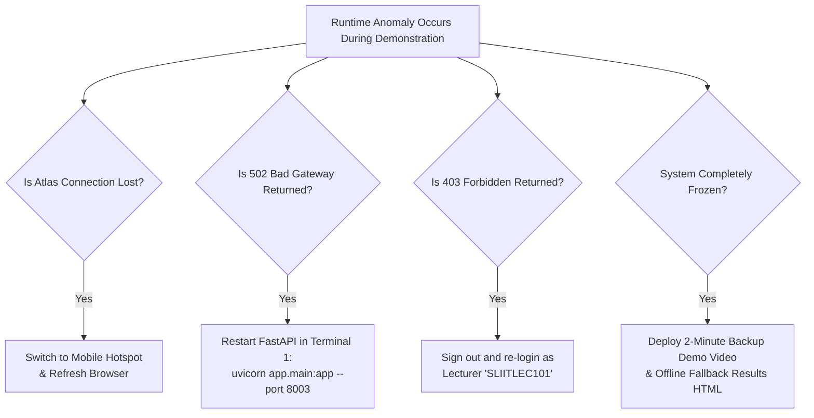

# AdaptiveLearnSE Component 3 — Risk Management & Contingency Plan

**Document Version:** 2.0.0  
**Target Milestone:** Project Performance 1 (PP1) / Viva Evaluation (22, 23, and 26 October 2026)  
**Component:** Component 3 (AI-Powered Automated Marking & Answer Analysis System)  

---

## 1. Risk Matrix Overview

| Risk ID | Risk Description | Category | Likelihood | Impact | Severity | Primary Mitigation Strategy |
| :--- | :--- | :--- | :--- | :--- | :--- | :--- |
| **RSK-01** | **MongoDB Atlas Network Drop During Viva** | Operational | Medium | Critical | High | Maintain local hotspot backup; verify current IP address is whitelisted in MongoDB Atlas dashboard 30 minutes prior to session. |
| **RSK-02** | **Python AI Service Crash / Port 8003 Unreachable** | System | Low | Critical | High | Express backend detects unreachable AI service and returns explicit HTTP 502 with diagnostic prompt. Rapid restart script prepared in runbook. |
| **RSK-03** | **Examiner Inquiries Regarding Higher RMSE** | Academic | High | Moderate | Medium | Present the mathematical trade-off: discrete rubric step-drops penalize missing concepts with large squared residuals, whereas token overlap is artificially smooth. Emphasize 17.3% MAE reduction. |
| **RSK-04** | **Examiner Challenges 0.34 ms Latency** | Academic | High | Moderate | Medium | Immediately clarify the latency scope: 0.34 ms is local in-process Python CPU execution time; full-stack web round-trip is ~45–80 ms. |
| **RSK-05** | **Examiner Inquiries Regarding Synthetic Data** | Academic | High | Moderate | Medium | Deliver the institutional ethics disclosure: authentic exam papers require formal IRB approval. A controlled 1,002-answer benchmark preserves academic integrity. |
| **RSK-06** | **Examiner Questions Feedback / Mind Map Validity** | Academic | Medium | Moderate | Medium | Disclose transparently that 100% validity represents structural schema compliance and DAG root reachability, not human pedagogical certification. |
| **RSK-07** | **Accidental Port Conflict on Developer Machine** | System | Low | High | Medium | Verify that ports 3000 (Express), 5173 (Vite), and 8003 (FastAPI) are free before startup using `Get-NetTCPConnection`. |

---

## 2. Technical Failure Recovery Procedures

---

## 3. Academic Defense Talking Points

### Talking Point 1: Why is the Baseline RMSE Lower than the Proposed System?
- **Auditor Script:** *"The token-overlap baseline outputs a smooth, continuous linear function of word overlap, which avoids sharp prediction drops. In contrast, our rubric engine enforces discrete educational criteria: missing a core concept drops the criterion score to zero. When evaluated against intermediate ground-truth scores, these step drops produce larger residuals, which are squared in RMSE. However, in classroom practice, token overlap is invalid because it over-awards marks to verbose answers filled with keywords, as proven by its failure on irrelevant responses (Section 3.2)."*

### Talking Point 2: Does the System Really Mark Answers in 0.34 ms?
- **Auditor Script:** *"The 0.34 ms figure represents purely the local algorithmic CPU execution time within Python (token extraction, regex matching, scoring level assignment, and DAG synthesis). When accounting for Express HTTP dispatch, network serialization, and MongoDB Atlas database writes, total end-to-end web latency in the browser is approximately 45 to 80 milliseconds—which still supports instantaneous, real-time feedback."*
