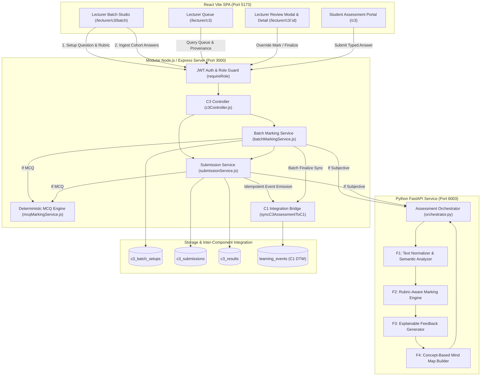

# AdaptiveLearnSE Component 3 — Architecture & Data Flow Specification

**Document Version:** 1.0.0  
**Scope:** Component 3 (AI-Powered Automated Marking & Answer Analysis System)  
**Target Milestone:** PP1 Viva Evaluation (22 October 2026)

---

## 1. System Architecture Overview

AdaptiveLearnSE Component 3 is structured into a modern three-tier modular architecture:
1. **Presentation Layer (React Vite SPA):** Modular UI components for student assessment submission, lecturer review queue, batch marking studio, and interactive SVG mind-map visualization.
2. **Application & Orchestration Layer (Node.js/Express):** JWT role-based security, request sanitization, batch cohort pre-validation, deterministic MCQ evaluation engine, MongoDB persistence, and Component 1 integration bridge.
3. **AI & NLP Analysis Layer (Python FastAPI):** High-performance Python service executing semantic text normalization, concept overlap diagnosis, multi-criterion rubric scoring, evidence linking, feedback generation, and mind map DAG construction.

---

## 2. Detailed Data Flow by Stage

### Stage 1: Assessment Setup
- Lecturer configures question metadata (`question_id`, `question_text`, `module_id`, `answer_type`, `max_marks`).
- For subjective questions: Defines multi-criterion rubric with scoring levels (`L0` to `Ln`), descriptions, and required concepts.
- For MCQs: Configures at least two normalized options and designates the authoritative correct option ID.
- Stored in MongoDB collection `c3_batch_setups` with an authoritative `batch_id` (`BATCH-QID-TIMESTAMP`).

### Stage 2: Cohort Answer Import & Pre-Validation
- Lecturer inputs multiple student answers via structured CSV or dynamic grid rows.
- Endpoint: `POST /api/v1/c3/batch/validate`
- The `validateBatchAnswers` engine performs pre-marking validation:
  1. Detects and flags duplicate student IDs within the same cohort.
  2. Flags empty answers or missing student IDs with exact row references.
  3. For MCQs: Verifies that the selected option matches a valid configured choice.
  4. Segregates submissions into `valid_items` and `invalid_items`, preventing malformed rows from crashing grading.

### Stage 3: Automated Marking Execution
- Endpoint: `POST /api/v1/c3/batch/mark`
- Evaluates valid items iteratively using appropriate pipeline:
  - **MCQ Flow:** Handled directly in Node.js via `mcqMarkingService.js`. Compares selected option against answer key. Assigns 0 or `max_marks`. Formats criterion evidence and concept matches deterministically in 0ms.
  - **Subjective Flow:** Transmitted via HTTP POST to `aiClient.assessAnswer` (`http://127.0.0.1:8003/c3/assess`).
    1. `F1: Text Normalizer & Semantic Analyzer` segments sentences, tokenizes words, and measures lexical similarity against reference answer and expected concepts.
    2. `F2: Rubric-Aware Marking Engine` evaluates each criterion independently, determining the highest scoring level supported by lexical concept evidence.
    3. `F3: Feedback Generator` generates constructive feedback: overall summary, demonstrated strengths, missing concepts, and actionable advice.
    4. `F4: Mind Map Generator` constructs a directed acyclic graph (DAG) rooted at the question, branching into demonstrated and missing concept nodes.
- **Error Isolation:** If evaluation fails for an individual student (e.g. timeout or malformed characters), the error is isolated to that student record (`status: failed`). The rest of the batch completes successfully.

### Stage 4: In-Place Persistence & Duplicate Prevention
- Submissions and results are upserted into `c3_submissions` and `c3_results`.
- If a submission already exists for `(student_id, batch_id)`, it is updated in-place without creating duplicate rows (`submissionService.js:89-135`).
- The submission status is set to `pending_review` (AI Proposed), enforcing the human-in-the-loop requirement.

### Stage 5: Lecturer Review, Override & Finalization
- Lecturer inspects student results in `/lecturer/c3/batch` or `/lecturer/c3/:id`.
- The modal presents criterion scores, highlighted student sentences, feedback, and interactive SVG mind map.
- **Score Override:** If the lecturer adjusts a mark, a mandatory justification (`override_reason`) is required (`submissionService.js:375-378`). The original automated mark is preserved in `automated_mark`, while the override is recorded in `final_mark`.
- **Finalization:** The lecturer finalizes results either individually (`POST /submissions/:id/finalize`) or in bulk (`POST /batch/:batchId/finalize-all`). Status transitions to `finalized`.

### Stage 6: Component 1 Integration Contract
- Component 3 integrates with Component 1 (Cognitive Digital Twin) through `syncC3AssessmentToC1`.
- Synchronizes assessment events to the MongoDB `learning_events` collection:
  - At submission: Records provisional learning event (`lifecycle_stage: 'provisional'`, `provisional_score`).
  - At finalization: Updates record in-place (`lifecycle_stage: 'finalized'`, `final_score`, `lecturer_decision`, `override_reason`).
  - Idempotent: Repeated calls update by `submission_id` using MongoDB `findOneAndUpdate`, preventing duplicate events.

---

## 3. Network & Service Boundaries

| Service Tier | Process / Command | Listening Port | Protocol | Inter-Service Dependencies |
| :--- | :--- | :--- | :--- | :--- |
| **Frontend** | `npm run dev` (Vite) | `http://localhost:5173` | HTTP / WS (HMR) | Proxies/Calls Express Backend |
| **Backend** | `node src/server.js` | `http://localhost:3000` | HTTP REST / JSON | Calls Python AI Service; Connects to MongoDB Atlas |
| **Python AI** | `uvicorn app.main:app` | `http://127.0.0.1:8003`| HTTP REST / JSON | Self-contained NLP & Rubric Engine |
| **MongoDB Atlas**| Cloud Cluster | Port 27017 / SRV | TCP / TLS | Stores `c3_*` and `learning_events` |
