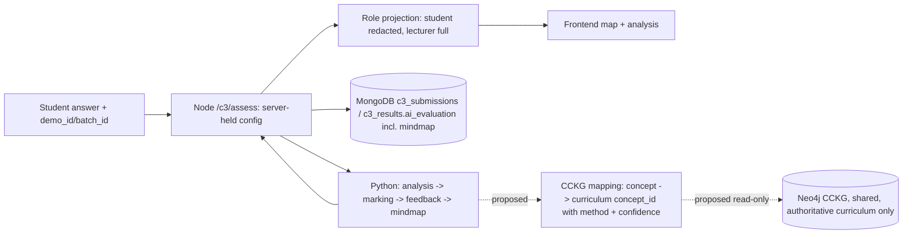

# C3 semantic marking experiment, mind-map persistence and MongoDB/Neo4j architecture review (2026-10-21)

Status vocabulary: IMPLEMENTED AND VERIFIED / PARTIALLY IMPLEMENTED / PROPOSED / BLOCKED / NOT TESTED. Nothing in this report is committed. Live `/assess` behaviour was **not** changed by this work.

## 1. Semantic marking (FR-C3-09): exploratory experiment only
**Read this first:** the labels are **author-labelled by construction** (the answers and their per-concept labels were written by the assistant before any model ran), the data are synthetic, and no human marker has checked them. The held-out split has 21 answers / 63 concept judgments, so the intervals are wide (answer-bootstrap F1 95% CI about 0.53–0.88 for the embedding methods, which also ignores dependence between the three judgments per answer). **These results are exploratory. They are not evidence of marking accuracy, and no human-validated accuracy is claimed.**

### Design
- Fixtures: `ai-services/c3/experiments/semantic_matching/fixtures.json`, 9 items × 7 answer types (exact, paraphrase, partial, lexically-similar-but-wrong, irrelevant, keyword-stuffed long, concise-correct) × 3 concepts = 63 answers. Split by item, no concept shared: dev 3 items (inspection only, nothing fitted), validation 3, test 3. Marks follow the rubric rule L0/L2/L4 (0 / 1–2 / all 3 demonstrated concepts) applied to the **construction labels**, never to model output.
- Methods on identical fixtures: M0 current lexical rule (`token_overlap_score == 1.0`, existing rule, not tuned); M1 MiniLM (all-MiniLM-L6-v2, local, cached) best-sentence cosine to the concept name; M2 the same with a lecturer-style concept description; M3 hybrid with a pre-specified lexical negation guard; M3b the same hybrid without the guard; M4 length-only shortcut baseline.
- Protocol: `run_eval select` loads only dev + validation and writes `frozen_config.json` (thresholds / hybrid weight chosen on validation F1, ties to the stricter threshold); `run_eval evaluate` refuses to run if the fixtures changed after freezing and scores the test split once. Tests (`tests/unit/test_semantic_matching_experiment.py`, 8) check split disjointness, label rules, that paraphrases really avoid the concept wording, that `select` never loads the test split, and that the frozen file matches the fixtures. A deviation to disclose: M3's negation guard proved harmful on **validation** (it flags legitimate phrases like "keeps no client session"), so M3b was added after seeing validation results only; the test split had not been loaded. No existing threshold or test was changed.

### Held-out test results (frozen configuration, run once)
| Method | Precision | Recall | F1 | AUC | Mark MAE (of 4) | Partial answers marked correctly | FP / FN / TP / TN |
|---|---|---|---|---|---|---|---|
| M0 lexical (current) | 0.51 | 0.67 | 0.58 | 0.54 | 1.81 | 3/3 | 19 / 10 / 20 / 14 |
| M1 MiniLM, name | 0.58 | 1.00 | 0.73 | 0.61 | 1.33 | 1/3 | 22 / 0 / 30 / 11 |
| M2 MiniLM, description | 0.58 | 0.97 | 0.73 | 0.76 | 1.33 | 2/3 | 21 / 1 / 29 / 12 |
| M3 hybrid + negation guard | 0.49 | 1.00 | 0.66 | 0.70 | 1.90 | 0/3 | 31 / 0 / 30 / 2 |
| M3b hybrid, unguarded | 0.58 | 0.97 | 0.73 | 0.76 | 1.33 | 2/3 | 21 / 1 / 29 / 12 |
| M4 length-only | 0.48 | 1.00 | 0.65 | 0.54 | 2.00 | 0/3 | 33 / 0 / 30 / 0 |
M3b selected weight 1.0, i.e. it collapses to M2. M4 on validation predicts "demonstrated" for everything (F1 0.65 is the all-positive score).

### What the numbers mean
- **Paraphrases:** lexical recall on paraphrase answers 0/9 concept judgments; MiniLM 0.89–1.00. This is the intended improvement and it is real on these fixtures.
- **False positives are the problem.** Every embedding method accepted 100% of the keyword-stuffed and lexically-similar-but-wrong answers (they are topically on-subject). Bi-encoder similarity measures relatedness, not correctness, so the gain trades missed paraphrases for false credit; lexical matching also accepted all of those answers. Irrelevant answers were rejected by M1/M2/M3b (0% FPR).
- **Versus the length baseline:** the all-positive length rule scores F1 0.65 and AUC 0.54, so the F1 gain of 0.73 is modest (AUC 0.76 vs 0.54 is the clearer signal). The earlier finding that a length-only model beats TF-IDF/SBERT on the tier dataset is consistent with this caution; fixtures here are length-overlapped by design (keyword-stuffed and paraphrase answers are longer than concise-correct ones), tested in the suite.
- **Calibration (Platt fitted on validation, applied to test, primary candidate):** Brier 0.21, ECE(5 bins) 0.11; coarse because n is small.
- **Runtime:** model first call 8.3 s (one-off load), 0.48 s to embed and score the 21 test answers (about 23 ms per answer, CPU); lexical rule is microseconds. Resource: about 90 MB model weights, already cached locally; no network.
- **Secondary check on the templated repaired v2 test split** (356 concept judgments from its own annotations): lexical F1 0.97, MiniLM name F1 0.92, length-only 0.91. Those answers quote the concept words verbatim, so the set cannot test paraphrase and says nothing about semantic skill.
- Conclusion: **FR-C3-09 remains FAIL (not met in the live system).** A bi-encoder alone is not a sufficient semantic marker; a rubric-aware design needs an entailment/contradiction signal (cross-encoder NLI or an LLM, currently blocked: no quota/credentials and no local NLI weights cached) in addition to similarity. Lecturer-defined accepted alternatives remain an optional explicit rubric feature, not evidence of semantic understanding.

### Proposed validation experiment (not run)
Two or more independent human markers label concept-level and mark-level outcomes for a larger set (at least 150 real or realistically written answers over at least 10 questions, including paraphrases and misconceptions), blind to model output; report inter-marker agreement (Cohen's kappa / QWK) first; fix the split by question; select thresholds on validation only; evaluate the frozen method once; add a cross-encoder NLI condition and an LLM judge when access exists; report FP/FN on stuffed and contradictory answers separately.

## 2. Verified architecture: AS-IS versus agreed target
| Item | Verified AS-IS | Status |
|---|---|---|
| Mind-map generation | Python `services/mindmap` (`generator.py`, `relationship_builder.py`), called inside `/c3/assess`; MCQ maps are built in Node (`mcqMarkingService`) | IMPLEMENTED AND VERIFIED |
| Mind-map persistence | **No separate collection or model.** The whole AI response is stored as `c3_results.ai_evaluation` (the map is `ai_evaluation.mindmap`) in MongoDB collections `c3_submissions`, `c3_results`, `c3_batch_setups`; verified earlier by reading maps back after a backend restart (functional F-H1) | IMPLEMENTED AND VERIFIED (as an embedded document) |
| Mind-map in Neo4j | Not stored; no code path writes answer maps to Neo4j | not implemented (agreed target unclear: see below) |
| Relationships | Only root→concept `child` links ("Deterministic baseline structural attachment") | PARTIALLY IMPLEMENTED (FR-C3-33 FAIL) |
| CCKG in Neo4j | Exists in the repo: `database/neo4j/schema/01_cckg_constraints.cypher`, seeds `cypher/01_seed_curriculum_ontology.cypher` (4 modules, 7 topics, 8 concepts, PREREQUISITE_OF edges) and `02_seed_assessment_mappings.cypher`, loader `scripts/load_cckg.sh`, Python adapter `services/cckg/graph_adapter.py` (live Neo4j with an explicit in-memory fallback; `C3_CCKG_STRICT=1` forbids the fallback) and a `-m neo4j` live test | PARTIALLY IMPLEMENTED |
| Neo4j operational check | In a **separate throwaway container** on other ports (the existing `adaptivelearnse-neo4j` was not touched; the throwaway was removed afterwards): started in about 9 s, schema and seeds loaded (Concept 8, Module 4, SyllabusTopic 7, Question 2, CurriculumResource 2; relationship types CITED_IN 4, CONTAINS_TOPIC 7, EVALUATES_CONCEPT 5, INTRODUCES_CONCEPT 8, PREREQUISITE_OF 4), adapter reported `neo4j_live` in strict mode, `retrieve_graphrag_context` returned prerequisite chain and citations from the live graph | IMPLEMENTED AND VERIFIED (adapter + seed, isolated) |
| GraphRAG in marking | Used only by experiment conditions; **not** on `/c3/assess`. Seed has 8 demo concepts and 2 questions, so it cannot support the proposal's curriculum coverage; approval of the ontology/data is not documented | BLOCKED (no approved populated CCKG; live LLM access also missing) |
| Backend ↔ Neo4j | No Neo4j driver in `backend/package.json`; Node never queries the graph | NOT IMPLEMENTED (shared decision) |
| Existing live-test config | `tests/integration/test_neo4j_live.py` reads `ai-services/c3/.env`; it was not run against the user's own Neo4j in this review | NOT TESTED |

### Data flow (current, with the proposed optional parts marked)

Design recommendation (PROPOSED): keep the answer-specific map as an assessment artifact in MongoDB, either as now (embedded) or as a separate `c3_mindmaps` collection referencing `submission_id`; never write student-inferred relationships into the shared CCKG; if a mind-map concept is mapped to a CCKG concept, store `{cckg_concept_id, method, confidence, status: "suggested"}` beside it, never as an authoritative edge. Any shared CCKG schema/ownership change needs approval from the responsible team.

## 3. Mind-map relationships (FR-C3-33/34)
- Verified: relationships are structural root→concept only. Inputs available per answer: concept status, overlap, per-concept evidence sentence ids. No semantic relations can be derived from them without inventing them, and none were generated.
- **Evidence-backed co-occurrence is feasible** (concepts sharing an evidence sentence, e.g. "components" and "relationships" in sentence 2 of the exact-answer fixture; no shared sentence → no link). If added, it must be a separate visual type labelled **"mentioned together"**, keep the sentence id and quote, and never be described as a semantic relation. Not implemented in this pass (awaiting approval).
- Evidence needed for genuine relations: (a) lecturer-authored `concept_relations` in the setup (type, direction) shown only when both concepts are demonstrated; (b) authoritative CCKG edges (PREREQUISITE_OF) for concepts mapped with a recorded method/confidence; (c) a separately evaluated relation-extraction or entailment model with its own labelled evaluation. FR-C3-33 stays FAIL; FR-C3-34 PARTIAL.

## 4. Blockers
Shared: Neo4j driver and CCKG access from the Node backend, ownership/approval of the CCKG ontology and data, shared `app.js` hardening (see `proposed_shared_app_patch.md`). Data/model: human-marked answers, an NLI or LLM judge, LLM quota for RAG-vs-no-RAG and GraphRAG conditions. Integrations: C2→C3 and C3→C4 endpoints do not exist.

## 5. Reproduce
`cd ai-services/c3`, then `python -m experiments.semantic_matching.run_eval select` and `... evaluate` (set `HF_HUB_OFFLINE=1`; requires the cached MiniLM weights). Outputs: `frozen_config.json`, `reports/c3_remediation/experiments/semantic_matching_results.json`.
